# Current Portal API Core Model

This diagram reflects the persisted MikroORM entities in the portal API core. Authentication/session data managed outside PostgreSQL (such as Redis-backed sessions) is not shown. Many-to-many collections are shown as direct relationships; their MikroORM pivot tables are omitted.

```mermaid
erDiagram
    %% Users, authentication, administration, and publishers
    USER {
        uuid id PK
        string email UK
        string firstName
        string lastName
        string status
        datetime createdAt
        datetime updatedAt
    }

    ADMIN_USER {
        uuid id PK
        uuid userId FK
        datetime createdAt
    }

    ACCOUNT_IDENTITY {
        uuid id PK
        uuid userId FK
        string provider
        string providerAccountId
        string passwordHash
        json providerData
        datetime lastLoginAt
        datetime createdAt
        datetime updatedAt
    }

    ACCOUNT_AUTH_TOKEN {
        uuid id PK
        uuid userId FK
        string type
        string valueHash UK
        datetime expiresAt
        datetime consumedAt
        datetime createdAt
    }

    PUBLISHER {
        uuid id PK
        string name
        string slug UK
        string websiteUrl
    }

    PUBLISHER_MEMBER {
        uuid id PK
        uuid publisherId FK
        uuid userId FK
    }

    USER ||--o| ADMIN_USER : has_admin_record
    USER ||--o{ ACCOUNT_IDENTITY : authenticates_with
    USER ||--o{ ACCOUNT_AUTH_TOKEN : receives
    PUBLISHER ||--o{ PUBLISHER_MEMBER : has_members
    USER ||--o{ PUBLISHER_MEMBER : joins_as_member

    %% Game catalog, versions, listings, and taxonomy
    GAME {
        uuid id PK
        string title
        string slug UK
        text summary
        text description
        json cover
        uuid publisherId FK
        int estimatedLengthMinutesMin
        int estimatedLengthMinutesMax
        boolean isFeatured
        json mediaList
        datetime publishedAt
    }

    GAME_VERSION {
        uuid id PK
        uuid gameId FK
        text description
        string publisherVersion
        string runUrl
        datetime createdAt
        datetime publishedAt
    }

    PUBLIC_GAME_LISTING {
        uuid id PK
        uuid gameVersionId FK
        boolean isAvailable
        datetime createdAt
        datetime publishedAt
        datetime startAt
        datetime endAt
    }

    PUBLIC_GAME_LISTING_PRICE_GROUP {
        uuid id PK
        uuid publicGameListingId FK
        int price_minorUnitAmount
        string price_currency
    }

    PUBLIC_GAME_LISTING_PRICE_GROUP_LANGUAGE {
        uuid id PK
        uuid publicGameListingId FK
        uuid priceGroupId FK
        string language
    }

    GAME_CUSTOMIZATION {
        uuid id PK
        uuid gameVersionId FK
        json content
        datetime createdAt
        datetime publishedAt
    }

    TAXONOMY_TERM {
        uuid id PK
        string type
        string label
        string slug
    }

    GAME_TAXONOMY_TERM {
        uuid id PK
        uuid gameId FK
        uuid taxonomyTermId FK
        boolean isPrimary
        int sortOrder
    }

    PUBLISHER ||--o{ GAME : publishes
    GAME ||--o{ GAME_VERSION : has_versions
    GAME ||--o{ GAME_TAXONOMY_TERM : has_taxonomy
    TAXONOMY_TERM ||--o{ GAME_TAXONOMY_TERM : classifies
    GAME_VERSION ||--o{ PUBLIC_GAME_LISTING : has_public_listings
    PUBLIC_GAME_LISTING ||--o{ PUBLIC_GAME_LISTING_PRICE_GROUP : has_price_groups
    PUBLIC_GAME_LISTING ||--o{ PUBLIC_GAME_LISTING_PRICE_GROUP_LANGUAGE : prices_language
    PUBLIC_GAME_LISTING_PRICE_GROUP ||--o{ PUBLIC_GAME_LISTING_PRICE_GROUP_LANGUAGE : includes_language
    GAME_VERSION ||--o{ GAME_CUSTOMIZATION : has_customizations

    %% Institutions, courses, classrooms, and instructors
    INSTITUTION {
        uuid id PK
        string name
        string slug UK
        json cover
        text summary
        text description
        string websiteUrl
        string status
        datetime createdAt
        datetime updatedAt
    }

    COURSE {
        uuid id PK
        uuid institutionId FK
        string name
        string code
        string slug UK
        json cover
        text summary
        text description
        string status
        datetime createdAt
        datetime updatedAt
    }

    CLASSROOM {
        uuid id PK
        uuid institutionId FK
        string name
        string code
        string slug UK
        string language
        string courseType
        json cover
        text summary
        text description
        string status
        datetime createdAt
        datetime updatedAt
    }

    INSTRUCTOR {
        uuid id PK
        string name
        string slug UK
    }

    CLASSROOM_GAME_LISTING {
        uuid id PK
        uuid classroomId FK
        uuid gameVersionId FK
        string language
        string courseType
        string designatedPayor
        int price_minorUnitAmount
        string price_currency
        int includedLicenseQuantity
        int licenseDurationDays
        uuid customizationId FK
        datetime startAt
        datetime endAt
        datetime publishedAt
        datetime createdAt
        datetime updatedAt
    }

    INSTITUTION ||--o{ COURSE : offers
    INSTITUTION ||--o{ CLASSROOM : contains
    INSTITUTION }o--o{ INSTRUCTOR : has_instructors
    CLASSROOM }o--o{ COURSE : includes
    CLASSROOM }o--o{ INSTRUCTOR : assigns
    CLASSROOM }o--o{ TAXONOMY_TERM : has_taxonomy
    CLASSROOM ||--o{ CLASSROOM_GAME_LISTING : lists
    GAME_VERSION ||--o{ CLASSROOM_GAME_LISTING : selected_for
    GAME_CUSTOMIZATION o|--o{ CLASSROOM_GAME_LISTING : optionally_customizes

    %% Licenses, purchases, redemptions, and payment processing
    GAME_LICENSE {
        uuid id PK
        uuid userId FK
        uuid classroomGameListingId FK
        uuid gameVersionId FK
        string language
        string courseType
        uuid customizationId FK
        datetime startAt
        datetime endAt
        datetime createdAt
    }

    GAME_PAYMENT_ATTEMPT {
        uuid id PK
        uuid userId FK
        uuid publicListingId FK
        uuid publicListingPriceGroupId FK
        uuid classroomGameListingId FK
        uuid customizationId FK
        string stripeCheckoutSessionId UK
        string stripePaymentIntentId
        string status
        int price_minorUnitAmount
        string price_currency
        datetime publicListingEndAtSnapshot
        boolean publicListingEndAtSnapshotted
        string language
        string courseType
        int licenseDurationDays
        datetime createdAt
        datetime fulfilledAt
    }

    ACQUISITION_CODE {
        uuid id PK
        string codeDigest UK
        string codeSuffix
        uuid classroomGameListingId FK
        datetime expiresAt
        datetime revokedAt
        datetime createdAt
    }

    ACQUISITION_CODE_REDEMPTION {
        uuid id PK
        uuid acquisitionCodeId FK
        uuid redeemedById FK
        datetime redeemedAt
    }

    GAME_ACQUISITION {
        uuid id PK
        uuid userId FK
        uuid publicListingId FK
        uuid classroomGameListingId FK
        uuid licenseId FK
        uuid codeRedemptionId FK
        uuid paymentAttemptId FK
        string mechanism
        int price_minorUnitAmount
        string price_currency
        datetime createdAt
    }

    GAME_ACQUISITION_EVENT {
        uuid id PK
        uuid acquisitionId FK
        uuid acquisitionCodeId FK
        string eventType
        string actorType
        uuid actorUserId FK
        text reason
        string providerReference
        string correlationId
        json metadata
        datetime createdAt
    }

    STRIPE_WEBHOOK_EVENT {
        uuid id PK
        string stripeEventId UK
        string eventType
        string status
        string failureMessage
        datetime createdAt
        datetime processedAt
    }

    USER ||--o{ GAME_LICENSE : owns
    CLASSROOM_GAME_LISTING o|--o{ GAME_LICENSE : contextualizes
    GAME_VERSION ||--o{ GAME_LICENSE : licenses
    GAME_CUSTOMIZATION o|--o{ GAME_LICENSE : optionally_customizes
    USER ||--o{ GAME_PAYMENT_ATTEMPT : starts
    PUBLIC_GAME_LISTING o|--o{ GAME_PAYMENT_ATTEMPT : may_be_purchased
    PUBLIC_GAME_LISTING_PRICE_GROUP o|--o{ GAME_PAYMENT_ATTEMPT : selects_price
    CLASSROOM_GAME_LISTING o|--o{ GAME_PAYMENT_ATTEMPT : may_be_paid_for
    GAME_CUSTOMIZATION o|--o{ GAME_PAYMENT_ATTEMPT : optionally_customizes
    CLASSROOM_GAME_LISTING o|--o{ ACQUISITION_CODE : may_have_codes
    ACQUISITION_CODE ||--o{ ACQUISITION_CODE_REDEMPTION : is_redeemed
    USER ||--o{ ACQUISITION_CODE_REDEMPTION : redeems
    USER ||--o{ GAME_ACQUISITION : makes
    PUBLIC_GAME_LISTING o|--o{ GAME_ACQUISITION : may_be_acquired
    CLASSROOM_GAME_LISTING o|--o{ GAME_ACQUISITION : may_be_acquired
    GAME_LICENSE ||--o{ GAME_ACQUISITION : fulfilled_as
    ACQUISITION_CODE_REDEMPTION o|--o| GAME_ACQUISITION : may_fulfill
    GAME_PAYMENT_ATTEMPT o|--o| GAME_ACQUISITION : may_fulfill
    GAME_ACQUISITION o|--o{ GAME_ACQUISITION_EVENT : records
    ACQUISITION_CODE o|--o{ GAME_ACQUISITION_EVENT : records
    USER o|--o{ GAME_ACQUISITION_EVENT : acts

    %% Persisted game runtime state and telemetry
    GAME_STATE {
        uuid id PK
        uuid gameLicenseId FK
        uuid gameVersionId FK
        int schemaVersion
        json content
        datetime savedAt
    }

    GAME_PLAY_EVENT {
        uuid id PK
        uuid gameLicenseId FK
        uuid gameVersionId FK
        string eventId
        string eventType
        int schemaVersion
        json payload
        datetime occurredAt
        datetime receivedAt
    }

    GAME_LICENSE ||--o| GAME_STATE : stores_state
    GAME_VERSION ||--o{ GAME_STATE : versions_state
    GAME_LICENSE ||--o{ GAME_PLAY_EVENT : emits
    GAME_VERSION ||--o{ GAME_PLAY_EVENT : versions_events
```



## Constraints

- `User.email`, `Game.slug`, `Publisher.slug`, `Institution.slug`, `Course.slug`, `Classroom.slug`, and `Instructor.slug` are unique.
- `AdminUser.user` is unique.
- `AccountIdentity(provider, providerAccountId)` and `AccountIdentity(user, provider)` are unique.
- `AccountAuthToken.valueHash` is unique.
- `GameVersion(game, publisherVersion)` is unique.
- `PublicGameListingPriceGroupLanguage(publicGameListing, language)` is unique, so each listed language has exactly one explicit price group and there is no fallback.
- `GameTaxonomyTerm(gameId, taxonomyTerm)` is unique; `TaxonomyTerm(type, slug)` is unique.
- `Course(institution, code)` and `Classroom(institution, code)` are unique.
- `AcquisitionCode.codeDigest` is unique; `AcquisitionCodeRedemption(acquisitionCode, redeemedBy)` is unique.
- `GamePaymentAttempt.stripeCheckoutSessionId` is unique when present.
- `GameAcquisition.codeRedemption` and `GameAcquisition.paymentAttempt` are each unique when present.
- `GameState.gameLicense` is unique.
- `GamePlayEvent(gameLicense, eventId)` is unique.
- `StripeWebhookEvent.stripeEventId` is unique.

## Value Types

```text
Media = { type: image | video, src: string, alt: string }
Money = { minorUnitAmount: integer, currency: Currency }
```

`Media` is stored as JSON. `Money` is embedded with `price_` prefixes in price groups, classroom game listings, acquisitions, and payment attempts. A `PublicGameListing` directly references one `GameVersion`; its price groups explicitly assign each language to one price, with no fallback. A `ClassroomGameListing` directly references one `GameVersion` and snapshots the classroom's `language` and `courseType`. It also stores designated payor, optional student price, informational included-license quantity, license duration, availability window, publication date, and optional customization. Institution-funded listings leave `price` null, and included quantity is not enforced. Licenses directly reference the exact `GameVersion`, retain `language` and `courseType` snapshots, and may reference their source classroom listing and customization. Public checkout creates a standard (`courseType = standard`) license.

Payment attempts snapshot the selected price, language, course type, license duration, and customization; fulfillment uses those values rather than rereading mutable listing configuration. Listing windows are half-open `[startAt, endAt)` intervals, so adjacent windows do not overlap. A publisher cannot have overlapping windows for the same GameVersion and configuration, and a classroom cannot have overlapping windows for the same GameVersion and configuration. Published classroom listing terms are immutable. Published public listing terms are immutable except that `endAt` may be moved earlier to close the listing. Acquisition codes are stored as digests and are scoped directly to a classroom game listing. Account session records are managed outside this relational model.

Optional entity references in the diagram correspond to nullable MikroORM relations. Payment source exclusivity and other transactional acquisition rules are enforced in application workflows rather than by additional database relationships.
